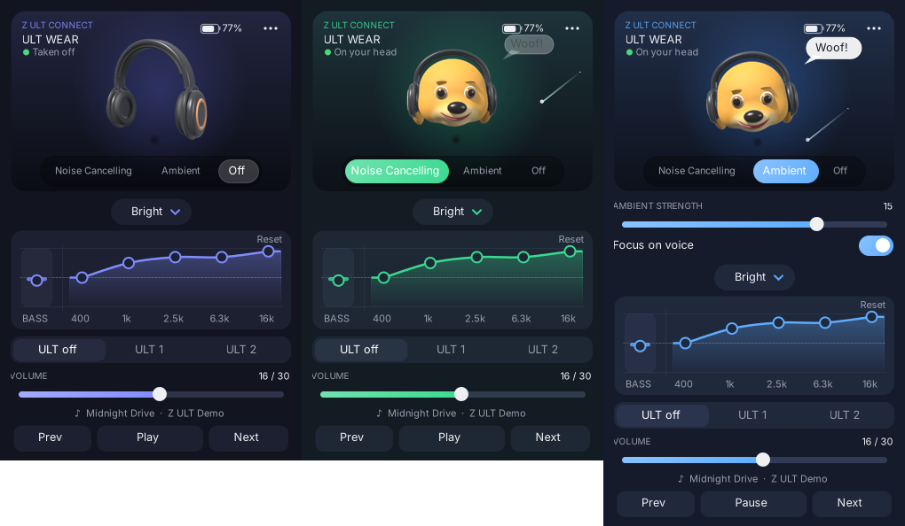
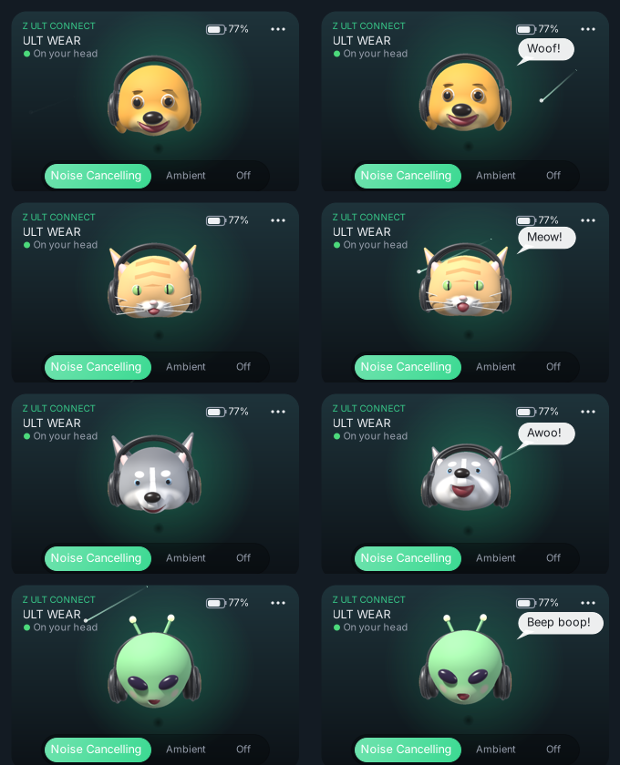

<p align="center">
  
</p>

<h1 align="center">Z ULT Connect</h1>

<p align="center">
  <b>Control your Sony ULT Wear headphones from the Windows tray, with a 3D companion that listens along.</b><br>
  Free · open source · no account · no telemetry
</p>

<p align="center">
  <a href="../../releases/latest"><b>⬇ Download the installer</b></a>
</p>

<p align="center">
  
</p>

Sony's Sound Connect app only exists for phones. **Z ULT Connect** brings the same controls to Windows.
It talks to the headphones directly over Bluetooth and lives in the system tray: one click and everything is there.

## Features

| | |
|---|---|
| 🎧 **Noise control** | Noise Cancelling, Ambient Sound or Off. The app glows green for Noise Cancelling and blue for Ambient |
| 🌬️ **Ambient sound** | Strength 1–20 and Focus on Voice |
| 🎛️ **Equalizer** | All presets plus **custom EQ**: drag the points on the curve (Bass, 400, 1k, 2.5k, 6.3k, 16k) |
| 🔊 **ULT bass** | ULT off, ULT 1 or ULT 2 |
| ✨ **DSEE** | On or off |
| 🔋 **Battery** | Live battery level |
| 🙂 **On your head** | Knows when you put the headphones on or take them off |
| 🎵 **Now playing** | Track, volume, play/pause, next, previous |
| ⏸️ **Pause when taken off**, ⏲️ **auto power off**, ⏻ **turn off** | In Settings |
| 🚀 **Start with Windows** | Starts quietly in the tray |

### Companions

When the headphones are on your head, a companion wears them. It bobs its head while music plays,
smiles, and now and then barks, meows, howls or beeps. Click it and it answers back.
Pick your favourite in **Settings → Companion**.

<p align="center">
  
</p>

## Install

1. Download **`Z-ULT-Connect-Setup.msi`** from the [latest release](../../releases/latest).
2. Double-click it. Windows may say *"Windows protected your PC"* because the installer isn't code-signed.
   Click **More info → Run anyway**.
3. Make sure your ULT Wear is **connected** to the PC in Windows Bluetooth settings.
4. Open **Z ULT Connect** from the Start menu. A headphone icon appears by the clock.
   Left-click it to open the panel, right-click for a quick menu.

Uninstall any time from **Settings → Apps**.

> **Tip:** if you can't see the tray icon, click the **^** arrow by the clock and drag the icon onto the taskbar.

## Compatibility

- **Windows 10 (1809+) or Windows 11**, 64-bit
- Made for and tested with **Sony ULT Wear (WH-ULT900N)**, firmware 2.1.0.
  Other recent Sony headphones that use the same protocol may partly work.
- Only one app can talk to the headphones at a time. Close other headphone apps first.

## Build from source

You need the free [.NET 10 SDK](https://dotnet.microsoft.com/download). No IDE required.

| Double-click | What it does |
|---|---|
| `run.bat` | Builds and starts the app |
| `run-demo.bat` | Starts with simulated headphones, so you can try everything without a ULT Wear |
| `build-exe.bat` | Makes a single `publish\ZUltConnect.exe` |
| `build-msi.bat` | Makes the installer `Z-ULT-Connect-Setup.msi` (uses the free WiX Toolset) |

Protocol tests: `dotnet run --project tests/ProtocolTests`

Every new **GitHub Release** builds the MSI automatically and attaches it to the release (see `.github/workflows/build.yml`).

## How it works

The headphones expose a classic Bluetooth serial channel (RFCOMM, service `956C7B26-D49A-4BA8-B03F-B17D393CB6E2`).
Z ULT Connect opens it and speaks Sony's "MDR v2" protocol: small framed messages like

```
3E | type | seq | length (4 bytes) | payload | checksum | 3C
```

Every message is acknowledged, and the app only uses features the headphones announce. Some details are specific to the ULT Wear.
For example, EQ presets must be sent through the combined "EQ + ULT mode" message (`58 03 …`).

```
Protocol/   framing, commands, state, a simulated ULT Wear for testing
Bluetooth/  finding and connecting to the headphones on Windows
App/        tray icon, connection, settings, log
UI/         the panel, the animated 3D screen, controls
Assets/     pre-rendered 3D frames (made with Assets/render.py and Assets/companions.py)
Installer/  the MSI definition (WiX Toolset)
tests/      protocol tests
```

The 3D headphones and companions are original models, ray-marched in Python/NumPy (`Assets/*.py`) and played back as flip-book frames.

## Privacy

Z ULT Connect collects nothing. See [PRIVACY.md](PRIVACY.md).

## Credits

- Protocol details from [SonyHeadphonesClient](https://github.com/mos9527/SonyHeadphonesClient) by mos9527 and contributors (MIT). See [THIRD_PARTY_NOTICES.md](THIRD_PARTY_NOTICES.md).
- Inspired by [XM Connect](https://github.com/omidkrm/xm-connect) for macOS.

## Disclaimer

Z ULT Connect is an independent project and is **not affiliated with, endorsed by or supported by Sony**.
"Sony", "ULT WEAR", "Sound Connect" and "DSEE" are trademarks of Sony Group Corporation, used here only to describe compatibility.

## License

[MIT](LICENSE)
